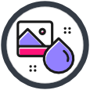
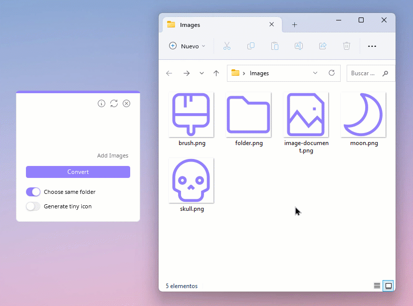
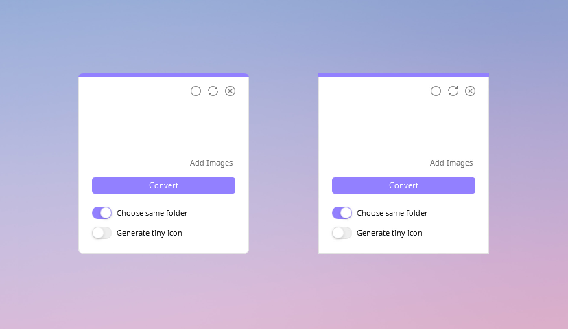

<p align="center"></p>
<p align="center"><a href="#"></a></p>
<h1 align="center">Drop Icons</h1>
<p align="center">Drop Icons is an app to convert images to icons (.ico) for Windows, with a simple Drag and Drop feature.</p>

<p align="center">
 <a href="LICENSE"></a>
 <a href="https://github.com/genesistoxical/drop-icons/releases/latest"></a>
 <a href="#"></a> 
 <a href="/installer%20src"></a>
 <a href="#"></a>
</p>

<p align="center">
<b>• Supported Languages •</b>
</BR>
‎ ‎ ‎ ‎ ‎ ‎ ‎ ‎ ‎ ‎ ‎ ‎ 
</p>

<p align="center">
<a href="README.md">README - English</a> :speech_balloon: <a href="README-es.md">README - Español</a>
</p>

## Features

- Clean and intuitive interface.
- Quickly convert multiple images to icons at once, with Drag and Drop feature.
- Support for .png .jpg .jpeg .jfif .bmp .gif and .svg images.
- Customize theme color.
- Customize the initial window position and screen-edge margin through
  Config.ini.
- Number of images to convert, subtracting three that are displayed as preview.
- Settings are saved in an .ini file, except for switches.
- Save icons in the same folder (default) or in a specific one.
- Enable and disable Topmost.
- Format options to choose sizes included within the icon, multiple and 256 px.
  [𝐢](#details)
- Prevent duplication of an image that has been previously added.
- Option to generate tiny icon.
- Adaptive corners (rounded or metro), depending on the OS version.

## Preview

<a href="#"></a>

## Usage

Drag and drop your images into the empty space, you will preview three images
except if you only drag one or two. Below you can see the total amount of images
to convert, subtracting three from preview. If you cannot drag, click on
`Add images`.

Leave the first switch on if you want to save them in the same folder, if you
prefer to choose a specific folder, turn it off. You can also generate a tiny
icon by turning on the second switch. Finally, click on `Convert` button, wait
for the interface to restart because this indicates that it has finished and
your icons are ready.

If you need to delete the images you have added by mistake, click on the arrows
icon. Remember that you can drag images as many times as you want before
clicking the `Convert` button.

<br id="details"/>
By clicking on the upper Info button, a new window will appear in which you can:

- **Change theme:** Click on `Change Theme` to open the color picker and choose
  a custom one, then click Apply. To return to default values, repeat the
  previous steps and press the purple button below the tone selector. Finally
  click Apply.

- **Change language:** In the **Language** section below, click on the little
  arrows icon to change between English, Español or Deutsch. Finally click on
  the return button to apply and see changes.

- **Format:** Clicking on `Format` will display a menu with two options to
  choose the sizes that will be included within the icon: **Multiple** generates
  a high quality icon that include all necessary sizes such as 16, 32, 48, 64,
  128 and 256 pixels, although the output dimensions will be 16px. The last two
  options are **256 px** and **512 px**, which generate an icon with only that
  size.
    > Note: If the **Generate tiny icon** switch is on, a small icon will be
    > created regardless of its format.
- **Third-party content:** On the left side are the names of each library,
  project, icons or fonts that were used, click one to read its license and
  author(s), as well as a short description. You can click on the clip icon to
  go to each repository/official site and change pages with **Next 🢖🢖** or **🢔🢔
  Back**.

<br>

To choose whether Drop Icons is on top of all windows (Topmost) or not,
right-click anywhere in the main window and choose Enable Topmost or Disable
Topmost.

You can also customize the main window's initial position and margin by editing
the `Config.ini` file. See [Config](#config) for available options.

## Options

<a href="#"></a>

## Installer

To compile the installer you need
[Inno Setup](https://jrsoftware.org/isinfo.php), the files are located in the
[installer src](/installer%20src) folder. You just need to open the project
(Installer.iss) and compile it, unless you want to make a change. When finished,
it will leave a folder called Output in the same location.

> - Please note that you must first compile the source code in Visual Studio to
>   get the binaries, otherwise you will get a
>   [📍Compiler Error](https://github.com/genesistoxical/drop-icons/issues/3).
> - Alternatively, you can download the compiled app from the Drop Icons
>   [page](https://genesistoxical.github.io/drop-icons/).

**Portable with 7zip.bat** allows you to quickly zip the portable version. It
only works with [7zip](https://www.7-zip.org/).

Both .iss and .bat get the files that are needed within their folder and/or the
Release folder (due to relative paths).

## Contributing

- **HandyControls** package will no longer be updated (for now or permanently)
  as the latest version does not allow resizing of ToggleButtonSwitch.
- If you make comments in the code, preferably in Spanish, please.
- Variable names must be in English.
- If you open an **Issue**, it can be in English o Spanish.
- **Pull request** in English, in the description you can add details in English
  or Spanish.

## Config

`Config.ini` file stores information about the language, theme color, icon
format, whether or not the Topmost option is enabled, and the initial window
position.

```
[Options]
Language = en
Topmost = false

[Theme]
#FF9280FF

[Format]
Size = multiple

[Window]
; Initial window position: TopLeft, TopRight, BottomLeft, BottomRight or Center
StartupPosition = BottomRight

; Distance from the screen's working area edges (WPF units)
Margin = 16
```

Window positioning uses the primary monitor's working area, excluding the
taskbar. These settings are applied when the main window opens.

> Note: The two switch-type options are not saved because they are not options
> that are usually activated all the time.

## Adaptive corners

<a href="#"></a>

## Credits

Drop Icons is based on [Iconizer](https://github.com/willnode/Iconizer) under
[MIT License](https://github.com/willnode/Iconizer/blob/master/LICENSE).

- [HandyControls](https://github.com/ghost1372/HandyControls) under
  [MIT License](https://github.com/ghost1372/HandyControls/blob/develop/LICENSE).

- [FolderBrowserEx](https://github.com/evaristocuesta/FolderBrowserEx) library
  under
  [MIT License](https://github.com/evaristocuesta/FolderBrowserEx/blob/master/LICENSE).

- [Noto Music](https://fonts.google.com/noto/specimen/Noto+Music) under
  [SIL Open Font License](/src/DropIcons/Docs/Noto%20Music/OFL.txt).

- Icons are part of [Teenyicons](https://github.com/teenyicons/teenyicons) under
  [MIT License](https://github.com/teenyicons/teenyicons/blob/master/LICENSE).

- [SVG](https://github.com/svg-net/SVG) under
  [MS-PL license](https://github.com/svg-net/SVG/blob/master/license.txt).
  <br><sub>This package includes five dependencies, read more details in this
  [file](/src/DropIcons/Docs/SVG%20%2B.txt).</sup>

- [WinVersion](https://github.com/shaovoon/win_version_detection) detection
  under
  [MIT License](https://github.com/shaovoon/win_version_detection/blob/main/LICENSE).

_You can find all licenses [here](/src/DropIcons/Docs)._

<br>

✨ Special thanks to the translators:

- German Translation by **uDEV2019**.
- Simplified Chinese Translation by **huqiu2**.
- French Translation by **logounet**.

## What's new?

`Version 3.1.0` includes one more language:
[📍German translation](https://github.com/genesistoxical/drop-icons/pull/6) for
both the application and installer. To avoid interface issues, updates for
**HandyControls** package have been disabled.

<br>

`Version 3.2.0` includes another language:
[📍Simplified Chinese language](https://github.com/genesistoxical/drop-icons/issues/8),
for app only.

<br>

`Version 3.6.0` another translation was added (Wow, thanks):
[📍French language](https://github.com/genesistoxical/drop-icons/issues/9), for
app only. Option to create 512px icons in **Format** was also included
[📍Please add 512 px](https://github.com/genesistoxical/drop-icons/discussions/10).

Now the **Language** option unfolds and a tooltip appears when you hover over
it, to show credits.

<br>

`Version 3.6.1` fixed an issue where context menus were in the wrong position on
some computers.

## License

**MIT License**

Copyright (c) 2022 - 2026 Génesis Toxical ([read here](LICENSE)).

<br>

## Related:

`🩷 Image to Icon` Convert image to icon online:
[`genesistoxical.github.io/imagetoicon`](https://genesistoxical.github.io/imagetoicon/)
or [`Repository`](https://github.com/genesistoxical/imagetoicon).

`🩷 Pixie Folders` Set of six minimalist and editable folder icon designs:
[`Download`](https://genesistoxical.github.io/pixie-folders/) or
[`Repository`](https://github.com/genesistoxical/pixie-folders).
