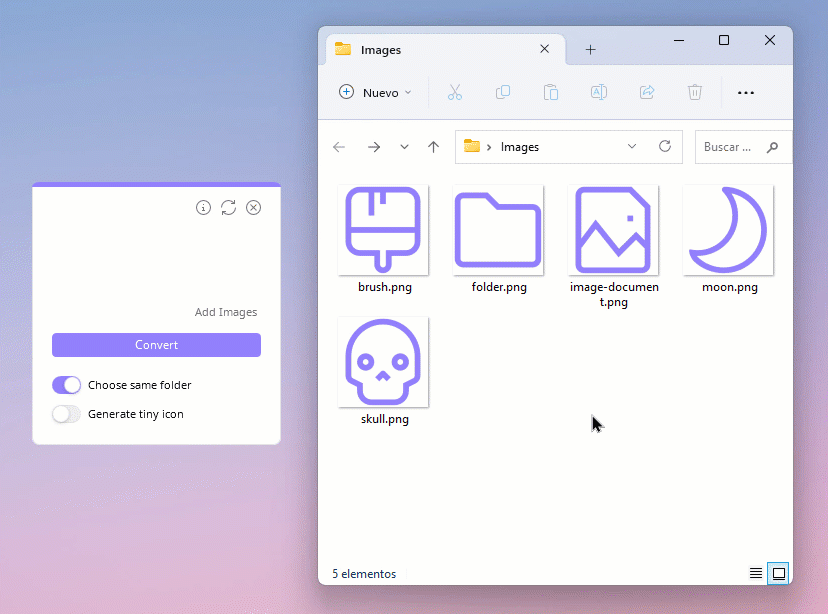

Drop Icons is an open source app to convert images to icons (.ico) for Windows, with a simple Drag and Drop feature.

Supported Languages

‎‎ ‎ ‎ ‎ ‎ ‎ ‎ ‎ ‎ ‎ ‎ ‎  ‎ ‎  ‎ ‎ 

## Features
* Clean and intuitive interface.
* Quickly convert multiple images to icons at once, with Drag and Drop feature.
* Support for .png .jpg .jpeg .jfif .bmp .gif and .svg images.
* Customize theme color.
* Number of images to convert, subtracting three that are displayed as preview.
* Settings are saved in an .ini file, except for switches.
* Save icons in the same folder (default) or in a specific one.
* Enable and disable Topmost.
* Format options to choose sizes included within the icon, multiple and 256 px. [𝐢](#details)
* Prevent duplication of an image that has been previously added.
* Option to generate tiny icon.
* Customize the initial window position and screen-edge margin through Config.ini.
* Adaptive corners (rounded or metro), depending on the OS version.

## Preview
<picture></picture>

## Usage
Drag and drop your images into the empty space, you will preview three images except if you only drag one or two. Below you can see the total amount of images to convert, subtracting three from preview. If you cannot drag, click on `Add images`.

Leave the first switch on if you want to save them in the same folder, if you prefer to choose a specific folder, turn it off. You can also generate a tiny icon by turning on the second switch. Finally, click on `Convert` button, wait for the interface to restart because this indicates that it has finished and your icons are ready.

If you need to delete the images you have added by mistake, click on the arrows icon. Remember that you can drag images as many times as you want before clicking the `Convert` button.

<br id="details"/>
By clicking on the upper Info button, a new window will appear in which you can:

- **Change theme:** Click on `Change Theme` to open the color picker and choose a custom one, then click Apply. To return to default values, repeat the previous steps and press the purple button below the tone selector. Finally click Apply.

- **Change language:** In the **Language** section below, click on the little arrows icon to change between English, Español or Deutsch. Finally click on the return button to apply and see changes.

- **Format:** Clicking on `Format` will display a menu with two options to choose the sizes that will be included within the icon: **Multiple** generates a high quality icon that include all necessary sizes such as 16, 32, 48, 64, 128 and 256 pixels, although the output dimensions will be 16px. The last two options are **256 px** and **512 px**, which generate an icon with only that size.
     >Note: If the **Generate tiny icon** switch is on, a small icon will be created regardless of its format.
     
- **Third-party content:** On the left side are the names of each library, project, icons or fonts that were used, click one to read its license and author(s), as well as a short description. You can click on the clip icon to go to each repository/official site and change pages with **Next 🢖🢖** or **🢔🢔 Back**.

<br>
To choose whether Drop Icons is on top of all windows or not, right-click anywhere in the main window and choose Enable Topmost or Disable Topmost.

<br>
You can also customize the main window's initial position and margin by editing the **Config.ini** file.

- Installer version location: _%AppData%\Drop Icons_
- Portable version includes it in the same folder.

**StartupPosition** options: `topleft`, `topright`, `bottomleft`, `bottomright` or `center`.

```
[Window]
StartupPosition = center
Margin = 56
```

## Options
<picture></picture>

## Info
* Drop Icons is based on [Iconizer](https://github.com/willnode/Iconizer){:target="_blank"}. Read more credits [here](https://github.com/genesistoxical/drop-icons#credits){:target="_blank"}.
* German Translation by **uDEV2019**.
* Simplified Chinese Translation by **huqiu2**.
* French Translation by **logounet**.
* Catalan Translation by **gg21kiy**, **JTE-19**.
* Portuguese Translation by **0xCHANDA**.
* This software is under **MIT License** ([read full text](https://github.com/genesistoxical/drop-icons/blob/master/LICENSE){:target="_blank"}).
* Copyright (c) 2022 - 2026 Génesis Toxical.
<br>
<style>
    h2.project-tagline:before {content: "Utility to convert images to icons ";}
    a.btn:nth-child(3):after {content: "ownload Portable";}
    a.btn:nth-child(4):after {content: "ownload Installer";}
</style>
